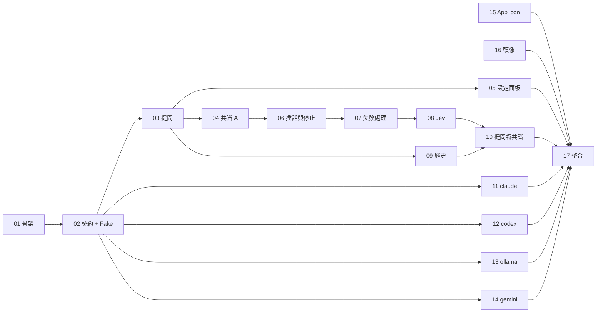

# aigora-v1 Tickets 總覽

Spec：`spec.md`。Tickets：`issues/` 下每張一個檔案。

## Tickets

| # | Ticket | Blocked by | 類型 |
|---|---|---|---|
| 01 | 骨架 | — | 程式 |
| 02 | 契約 + Fake Adapter | 01 | 程式 |
| 03 | 提問 tracer bullet | 02 | 程式 |
| 04 | 共識討論（方式 A） | 03 | 程式 |
| 05 | 設定面板 | 03 | 程式 |
| 06 | 插話與停止 | 04 | 程式 |
| 07 | 失敗處理 | 06 | 程式 |
| 08 | 共識裁定方式 B（Jev） | 07 | 程式 |
| 09 | 歷史清單 | 03 | 程式 |
| 10 | 提問轉共識討論 | 08、09 | 程式 |
| 11 | Adapter：claude | 02 | 程式 |
| 12 | Adapter：codex | 02 | 程式 |
| 13 | Adapter：ollama | 02 | 程式 |
| 14 | Adapter：gemini（需先徵求同意安裝） | 02 | 程式 |
| 15 | 美術：App icon + favicon | —（素材規格） | 美術 |
| 16 | 美術：6 張預設頭像 | —（素材規格） | 美術 |
| 17 | 整合 | 01–16 | 程式 + 人工驗收 |

## 依賴關係圖

## 可以並行的批次

依「不改同一批檔案、不需要對方的產出、介面已經定好」三個條件判斷：

| 批次 | 可同時進行 | 說明 |
|---|---|---|
| 一開始 | 01、15、16 | 美術只依賴素材規格，和程式不碰同一批檔案 |
| 02 完成後 | 03、11、12、13、14 | 各 Adapter 只新增自己的模組；registry 已在 01 註冊 |
| 03 完成後 | 04、05、09（＋仍在進行的 11–14） | 各自只改自己的頁面與元件；只有 04 動討論引擎 |
| 引擎鏈 | 04 → 06 → 07 → 08 依序 | 都要修改討論引擎，違反「不改同一批檔案」，不能並行 |
| 最後 | 10 → 17 | 10 需要 08（引擎）與 09；17 需要全部 |

## 熱點檔案擁有者

01 完成後若實際檔名與下表不同，由 01 更新本表。

| 熱點檔案 | 建立 / 擁有者 | 其他 ticket 的規則 |
|---|---|---|
| 後端依賴清單（`backend/pyproject.toml`、`backend/uv.lock`） | 01 | 不得修改；需要新套件時停下回報 |
| 前端依賴清單（`frontend/package.json`、`frontend/package-lock.json`） | 01 | 同上 |
| 後端路由註冊（`backend/aigora/api/routes.py`；所有 HTTP / WebSocket 端點先註冊為「未實作」）與 App 工廠（`backend/aigora/app.py`） | 01 | 不得修改；只實作 `backend/aigora/api/handlers/` 下各自端點的處理函式 |
| Adapter registry（`backend/aigora/adapters/registry.py`；5 個識別碼全部先註冊） | 01 | 不得修改；Adapter ticket 只填自己的模組 `backend/aigora/adapters/<id>.py` |
| 前端路由（`frontend/src/router.ts`；討論頁、歷史頁、唯讀紀錄頁） | 01 | 不得修改 |
| 前端主版面（`frontend/src/layouts/AppLayout.vue`） | 01 | 不得修改（17 換正式素材時例外） |
| 前端全域 store（`frontend/src/stores/discussion.ts`，匯出 `useDiscussionStore`） | 01 建立空殼、02 填入事件處理後凍結 | 不得修改 |
| WebSocket 訊息型別（`backend/aigora/api/messages.py`、`frontend/src/contracts/messages.ts`） | 02，完成後凍結 | 不得修改 |
| 測試設定（`backend/pyproject.toml` 的 pytest 段、`frontend/playwright.config.ts`、`frontend/vite.config.ts`） | 01 | 不得修改；E2E 參與者可加到 `frontend/e2e/participants.e2e.toml` |
| 討論引擎 | 03 建立，之後 04 → 06 → 07 → 08 依序擁有 | 其他 ticket 不得修改；需要時停下回報 |

## 共通規則（所有 ticket）

1. 不得修改上表中不屬於自己的熱點檔案。
2. **WebSocket 訊息型別凍結後，若某張 ticket 需要新的訊息類型，停下回報，不要自行修改。**
3. 04、05、09 只能修改自己的頁面與元件。
4. 真實 AI 的測試以標記區隔，預設不執行；只有手動要求與 CLI 升級後才跑。
5. 用語依 `GLOSSARY.md`；決策依 `docs/adr/`。
