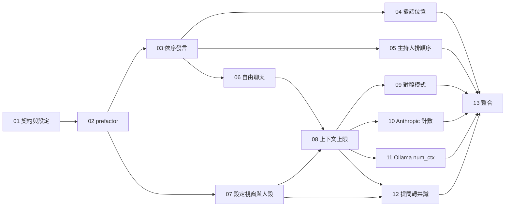

# aigora-v2 Tickets 總覽

Spec：`spec.md`。Tickets：`issues/` 下每張一個檔案。熱點檔案與負責的 ticket：`hot-files.toml`（合併前用 `scripts/check_hot_files.py` 檢查）。

## Tickets

| # | Ticket | Blocked by | 類型 |
|---|---|---|---|
| 01 | 契約與設定擴充（expand） | — | 程式 |
| 02 | 引擎與 Prompt Builder 的 prefactor | 01 | 程式（行為不變） |
| 03 | 依序發言（清單順序） | 02 | 程式 |
| 04 | 依序發言時插話從下一個發言生效 | 03 | 程式 |
| 05 | 主持人排定下一輪順序 | 03 | 程式 |
| 06 | 自由聊天 | 03 | 程式 |
| 07 | 參與者設定視窗與人設 | 02 | 程式 |
| 08 | 上下文上限與遺忘（本機估算） | 06、07 | 程式 |
| 09 | 對照模式 | 08 | 程式（前端） |
| 10 | Anthropic token 計數 | 08 | 程式 |
| 11 | Ollama 依上下文上限設定 num_ctx | 08 | 程式 |
| 12 | 提問轉共識討論改回到設定面板 | 07、08 | 程式 |
| 13 | 整合與驗收 | 01–12 | 程式 + 人工驗收 |

## 依賴關係圖

## 可以並行的批次

依「不改同一批檔案、不需要對方的產出、介面已經定好」三個條件判斷：

| 批次 | 可同時進行 | 說明 |
|---|---|---|
| 1 | 01 | 契約一次定好，之後的 ticket 不改契約檔 |
| 2 | 02 | 引擎與 Prompt Builder 的接點 |
| 3 | 03、07 | 03 改發言順序與發言版面；07 改參與者設定視窗與人設片段。共用 `SettingsPanel.vue`（03 只開放「依序」選項） |
| 4 | 04、05、06（07 若未完成也可繼續） | 04 改引擎的插話；05、06 都改 `modes.py`（不同的類別），合併時可能需要處理衝突 |
| 5 | 08 | 等 06、07 完成；碰引擎、Prompt Builder、設定頁、store |
| 6 | 09、10、11、12 | 09 純前端對照；10 計數器與金鑰；11 Ollama；12 轉換流程。12 與 09 都可能碰討論頁元件，注意衝突 |
| 7 | 13 | 文件、全檢查、人工驗收 |

## 熱點檔案

- 契約（WebSocket、HTTP、紀錄、`domain.py`、`config.py`）只由 01 修改。後面的 ticket 發現缺欄位時，在 ticket 的 Comments 記下，由協調者決定是否回頭修 01 或開新 ticket，不自行修改。
- 引擎、Prompt Builder、`modes.py`、設定頁、store 由多張 ticket 依序修改，見 `hot-files.toml`。
- `frontend/e2e/participants.e2e.toml` 與 `AGENTS.md` 所有 ticket 都可以改（只新增，不改既有參與者）。
