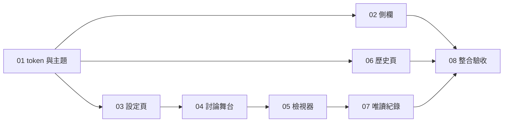

# ui-redesign Tickets 總覽

Spec：`spec.md`。Tickets：`issues/` 下每張一個檔案。視覺參考：`prototype/index.html`（方向 A）。

## Tickets

| # | Ticket | Blocked by | 類型 |
|---|---|---|---|
| 01 | 設計 token、基底樣式與主題機制 | — | 程式 |
| 02 | App 外框：側欄、最近的討論、主題切換 | 01 | 程式 |
| 03 | 設定頁（舞台＋檢視器） | 01 | 程式 |
| 04 | 討論舞台、插話列與檢視器骨架 | 03 | 程式 |
| 05 | 檢視器：參與者狀態與表態追蹤 | 04 | 程式 |
| 06 | 歷史頁表格 | 01 | 程式 |
| 07 | 唯讀紀錄 | 05 | 程式 |
| 08 | 整合與驗收 | 01–07 | 程式＋人工驗收 |

## 依賴關係圖

## 可以並行的批次

判斷標準和 aigora-v1 相同：不改同一批檔案、不需要對方的產出、介面已經定好。

| 批次 | 可同時進行 | 說明 |
|---|---|---|
| 一開始 | 01 | 其他 ticket 都要用到 token |
| 01 完成後 | 02、03、06 | 分別只改 `AppLayout`＋`components/layout/`、`SettingsPanel`、`HistoryPage`，互不重疊 |
| 主鏈 | 03 → 04 → 05 → 07 依序 | 03、04、07 都要修改 E2E 檔案（03 幾乎改到全部 spec），04 和 05 都要修改 `DiscussionInspector.vue`，07 需要 04 的共用樣式和 05 的展示元件 |
| 最後 | 08 | 需要全部完成 |

## 熱點檔案擁有者

本表在 ui-redesign 期間取代 `.scratch/aigora-v1/tickets-overview.md` 中同一個檔案的規則。

| 熱點檔案 | 擁有者 | 其他 ticket 的規則 |
|---|---|---|
| `frontend/src/styles/tokens.css`、`frontend/src/styles/base.css`、`frontend/src/composables/useTheme.ts`、`frontend/index.html`、`frontend/src/main.ts` | 01 | 不得修改；需要新 token 時停下回報 |
| `frontend/src/layouts/AppLayout.vue` | 01（只移除全域樣式）→ 02 | 其他 ticket 不得修改 |
| `frontend/src/pages/DiscussionPage.vue` | 04 | 不得修改 |
| `frontend/src/styles/discussion.css` | 04 | 07 只能新增 modifier class，不能改變討論中畫面的外觀 |
| `frontend/src/components/discussion/DiscussionInspector.vue` | 04 建立 → 05 | 其他 ticket 不得修改 |
| `frontend/src/components/discussion/InspectorParticipants.vue`、`StanceTracker.vue` | 05 | 07 只能使用；需要新的 prop 時只能新增，不能改變現有行為 |
| E2E spec 檔案（`frontend/e2e/*.spec.ts`） | 03（按鈕改名）→ 04（`settings-panel.spec.ts` 的鎖定斷言）→ 05（新增參與者斷言）→ 07（`history.spec.ts` 的唯讀斷言）；02 只新增 `theme.spec.ts` | 只能做 spec「刻意修改的測試」列出的改動 |
| 前端依賴清單（`frontend/package.json`、`frontend/package-lock.json`） | 無人 | 不得修改；需要新套件時停下來問使用者 |
| WebSocket 訊息型別、`frontend/src/stores/discussion.ts`、`frontend/src/router.ts`、`frontend/vite.config.ts`、`frontend/playwright.config.ts`、整個 `backend/` | 無人（凍結） | 不得修改。`backend/aigora/adapters/` 另有 session 在處理 |

## 共通規則（所有 ticket）

1. 不得修改上表中不屬於自己的熱點檔案。
2. 不改任何功能或行為；外觀以外的改動需要時，停下回報。
3. 既有的 `data-testid` 以及 role／label 選擇器都要能繼續使用。只能做 spec「刻意修改的測試」列出的改動，改的時候在 ticket 的 Comments 寫原因。
4. 完成時跑 `npm run typecheck --prefix frontend` 與 `cd frontend && npx playwright test`，並附亮色、暗色截圖。
5. 用語依 `GLOSSARY.md`。
