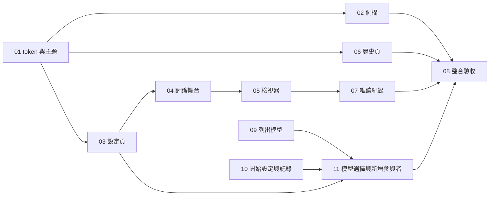

# ui-redesign Tickets 總覽

Spec：`spec.md`。Tickets：`issues/` 下每張一個檔案。視覺參考：`prototype/index.html`（方向 A）。模型列表的調查結果：`model-listing-findings.md`。

## Tickets

| # | Ticket | Blocked by | 類型 |
|---|---|---|---|
| 01 | 設計 token、基底樣式與主題機制 | — | 前端 |
| 02 | App 外框：側欄、最近的討論、主題切換 | 01 | 前端 |
| 03 | 設定頁（舞台＋檢視器） | 01 | 前端 |
| 04 | 討論舞台、插話列與檢視器骨架（含模型標籤） | 03 | 前端 |
| 05 | 檢視器：參與者狀態與表態追蹤 | 04 | 前端 |
| 06 | 歷史頁表格 | 01 | 前端 |
| 07 | 唯讀紀錄 | 05 | 前端 |
| 08 | 整合與驗收 | 01–07、09–11 | 前端＋後端＋人工驗收 |
| 09 | 後端：各 Adapter 列出可用模型 | — | 後端（＋`http.ts`） |
| 10 | 後端：開始設定的模型覆寫、臨時參與者與紀錄 | — | 後端（＋`messages.ts`） |
| 11 | 設定頁：模型選擇與新增參與者 | 03、09、10 | 前端 |

## 依賴關係圖

## 可以並行的批次

判斷標準和 aigora-v1 相同：不改同一批檔案、不需要對方的產出、介面已經定好。

| 批次 | 可同時進行 | 說明 |
|---|---|---|
| 一開始 | 01、09、10 | 01 只改前端樣式；09、10 只改後端，加上各自的 TS 契約檔（`http.ts`、`messages.ts`），彼此不重疊 |
| 01 完成後 | 02、03、06（＋仍在進行的 09、10） | 02、03、06 分別只改 `AppLayout`＋`components/layout/`、`SettingsPanel`、`HistoryPage` |
| 03、09、10 都完成後 | 11 與 04 可以同時進行 | 11 只改 `components/settings/`＋新的 `participant-models.spec.ts`；04 改 `DiscussionPage` 與 `components/discussion/` |
| 主鏈 | 03 → 04 → 05 → 07 依序 | 03、04、07 都要修改既有的 E2E 檔案，04 和 05 都要修改 `DiscussionInspector.vue`，07 需要 04 的共用樣式和 05 的展示元件 |
| 最後 | 08 | 需要全部完成 |

注意：E2E 固定使用 :8766（後端）與 :5174（Vite），同一台機器上兩個 session 同時跑 `npx playwright test` 會互相衝突。並行的 session 要錯開執行 E2E。

## 熱點檔案擁有者

本表在 ui-redesign 期間取代 `.scratch/aigora-v1/tickets-overview.md` 中同一個檔案的規則。

| 熱點檔案 | 擁有者 | 其他 ticket 的規則 |
|---|---|---|
| `frontend/src/styles/tokens.css`、`frontend/src/styles/base.css`、`frontend/src/composables/useTheme.ts`、`frontend/index.html`、`frontend/src/main.ts` | 01 | 不得修改；需要新 token 時停下回報 |
| `frontend/src/layouts/AppLayout.vue` | 01（只移除全域樣式）→ 02 | 其他 ticket 不得修改 |
| `frontend/src/components/settings/` | 03 → 11 | 其他 ticket 不得修改 |
| `frontend/src/pages/DiscussionPage.vue` | 04 | 不得修改 |
| `frontend/src/styles/discussion.css`、`frontend/src/components/discussion/ParticipantLabel.vue` | 04 | 05、07、11 只能使用；07 只能新增 modifier class，不能改變討論中畫面的外觀 |
| `frontend/src/components/discussion/DiscussionInspector.vue` | 04 建立 → 05 | 其他 ticket 不得修改 |
| `frontend/src/components/discussion/InspectorParticipants.vue`、`StanceTracker.vue` | 05 | 07 只能使用；需要新的 prop 時只能新增，不能改變現有行為 |
| 既有的 E2E spec 檔案（`frontend/e2e/*.spec.ts`） | 03（按鈕改名）→ 04（`settings-panel.spec.ts` 的鎖定斷言）→ 05（新增參與者斷言）→ 07 | 只能做 spec「刻意修改的測試」列出的改動。02 新增 `theme.spec.ts`，並且（實作時發現有必要）在 03 之後修改 `history.spec.ts` 的唯讀斷言，11 只新增 `participant-models.spec.ts` |
| `frontend/e2e/participants.e2e.toml` | 09（加 fake 模型） | 其他 ticket 不得修改 |
| HTTP 契約（`backend/aigora/api/http_models.py`、`frontend/src/contracts/http.ts`）、`backend/aigora/participant_info.py`、`backend/aigora/api/handlers/participants.py` | 09 | 不得修改 |
| `backend/aigora/adapters/base.py`、`claude.py`、`codex.py`、`ollama.py`、`fake.py` | 09（只能新增 `list_models`） | 不得修改。`gemini.py`、`registry.py`、隔離參數任何人都不能改（agy／gemini 另有 session） |
| WebSocket 契約（`backend/aigora/api/messages.py`、`frontend/src/contracts/messages.ts`）、`backend/aigora/discussion/settings.py`、`backend/aigora/api/handlers/discussion_socket.py`、`backend/aigora/record.py`、`frontend/src/contracts/record.ts` | 10 | 不得修改 |
| 前端依賴清單（`frontend/package.json`、`frontend/package-lock.json`）、後端依賴清單（`backend/pyproject.toml`、`backend/uv.lock`） | 無人 | 不得修改；需要新套件時停下來問使用者 |
| `frontend/src/stores/discussion.ts`、`frontend/src/router.ts`、`frontend/vite.config.ts`、`frontend/playwright.config.ts`、`backend/aigora/discussion/engine.py` 與其他引擎模組 | 無人（凍結） | 不得修改；需要時停下回報 |

## 共通規則（所有 ticket）

1. 不得修改上表中不屬於自己的熱點檔案。
2. 除了 spec「參與者與模型選擇」之外，不改任何功能或行為；需要外觀以外的改動時，停下回報。
3. 既有的 `data-testid` 以及 role／label 選擇器都要能繼續使用。只能做 spec「刻意修改的測試」列出的改動，改的時候在 ticket 的 Comments 寫原因。
4. 完成時要跑：
   - 前端 ticket：`npm run typecheck --prefix frontend`、`cd frontend && npx playwright test`，並附亮色、暗色截圖。
   - 後端 ticket：另外跑 `uv run --directory backend pytest`。
5. 用語依 `GLOSSARY.md`。
