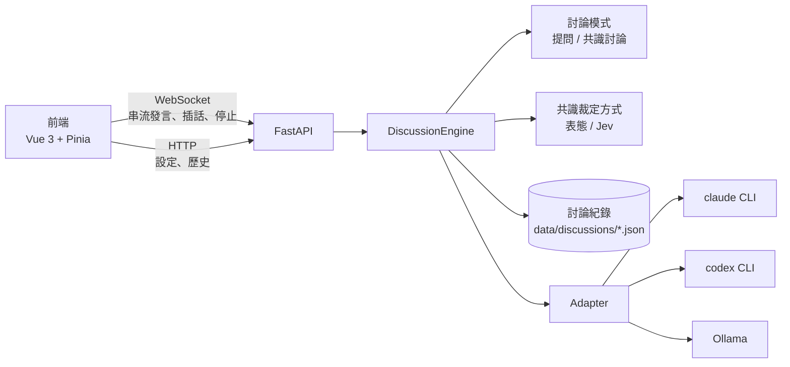

# AIgora

**讓多個 AI 在同一個視窗裡回答同一個問題、互相討論，直到取得共識。**

我同時在用 Claude Code、Codex CLI 等 AI 工具。同一個問題要開好幾個終端機分別問，再自己來回複製貼上比較答案。AIgora 把它們放進同一場討論：所有參與者的發言並排顯示，也可以讓它們看到彼此的看法、多輪接力討論，最後產出一份共識結果。

<!-- TODO: 在這裡放一張討論畫面截圖或 GIF，例如 docs/images/discussion.png -->

- **不用 API 金鑰**：直接驅動你已登入的 AI CLI（Claude Code、Codex CLI），沿用既有的訂閱額度
- **參與者碰不到你的檔案**：每個 Adapter 都會關掉 CLI 的 shell、檔案讀寫與 MCP 等本機工具，只留下上網查資料的能力，並有自動化的 canary 測試把關
- **本機執行**：後端只監聽 `127.0.0.1`，討論紀錄存在本機的 JSON 檔

## 功能

### 兩種討論模式

| 討論模式 | 說明 |
|---|---|
| **提問** | 所有參與者同時回答一輪，發言即時串流、並排顯示，方便直接比較 |
| **共識討論** | 參與者多輪接力討論，每輪都看得到之前所有人的發言。主持人在每輪結束後整理共識草案，其他參與者表態同意或不同意，直到取得共識或到達輪數上限 |

提問結束後，覺得值得深入討論，可以一鍵轉成共識討論。原本的提問發言直接當作第 1 輪，已經花掉的額度不會重來一次。

### 兩種共識裁定方式

- **方式 A：主持人 + 全員表態**（`stance_vote`）：從第 2 輪開始，每個參與者在發言結尾對上一輪的共識草案明確表態，全員同意就取得共識。
- **方式 B：Jev 判斷 + 反問確認**（`jev`）：由 TypeSafe 的 Jev 模型（`typesafe-sdk`）估計目前的共識機率，超過門檻後再反問每個參與者確認，全員同意才由主持人寫出最終結果。

### 討論控制

- **插話**：討論進行中隨時補充說明，會帶進下一輪所有參與者的 prompt
- **停止**：立即中止，保留已產生的部分發言並存成紀錄
- **失敗處理**：發言逾時或出錯時，該輪其他人繼續；連續兩輪都失敗的參與者會被移出討論；主持人失敗時，主持人的工作自動交給下一位參與者
- **單場設定**：開始前可以勾選參與者、切換模型、指定主持人、選擇裁定方式與輪數上限，也可以複製出同一種 AI 的額外參與者（例如兩個不同模型的 Claude）

### 歷史紀錄

每場討論都存成 JSON，側邊欄可以瀏覽過去的討論，查看每一輪的發言、表態、共識草案與最終結果。

## 支援的參與者

| Adapter | 接入方式 | 狀態 |
|---|---|---|
| `claude` | Claude Code CLI（`claude auth login`） | ✅ 真實 CLI 測試與 canary 通過 |
| `codex` | Codex CLI（ChatGPT 訂閱登入） | ✅ 真實 CLI 測試與 canary 通過 |
| `ollama` | 本機 Ollama HTTP API | ✅ 只改設定檔即可參加討論 |
| `gemini` | Gemini CLI | 🚧 v1 暫不使用：程式已寫好，但實機測試發現隔離設定沒有生效，修正前請勿啟用 |
| `fake` | 不呼叫任何 AI 的假參與者 | 開發與測試用 |

新增一種 AI 只需要寫一個 Adapter，並在 `participants.toml` 加一段設定。

## 設計決策

這個專案刻意做了兩個不太一樣的選擇，完整理由記錄在 [`docs/adr/`](docs/adr/)：

1. **驅動 AI CLI，而不是呼叫 API**（[ADR 0001](docs/adr/0001-drive-ai-clis-not-apis.md)）
   以子行程執行各家 CLI 的非互動模式，可以沿用已登入的訂閱帳號，不必另外申請金鑰或付費。代價是每個 CLI 的輸出格式、旗標與權限控制都不同，必須由各自的 Adapter 處理。每次發言都送出完整的討論內容，不使用 CLI 的 resume，讓所有 Adapter 行為一致，也讓沒有 session 概念的 Ollama 能接入。

2. **以移除本機工具來隔離參與者，而不是依賴 OS sandbox**（[ADR 0002](docs/adr/0002-isolate-by-removing-local-tools.md)）
   實測發現 Codex 的 `--sandbox read-only` 只禁止寫入、仍然能讀取整台電腦的檔案；Claude 的 `--tools` 也擋不住 claude.ai connector 等 MCP 工具。因此每個 Adapter 都把 shell、檔案讀寫、MCP、外掛、hooks 全部關掉，只留下網路搜尋，並忽略使用者自己的 CLI 設定檔。
   由於 CLI 升級可能加入新工具，每個 Adapter 都有一個 **canary 測試**：在工作資料夾外放一個內容隨機的檔案，要求參與者讀取，輸出中不得出現該內容。

## 架構



- **DiscussionEngine** 以單一 `DiscussionRecord` 作為狀態，負責每一輪的發言、逾時、失敗移除與主持人交接；討論模式、共識裁定方式與發言順序都是可替換的介面。
- **Adapter** 把每種 AI 的輸出統一轉成 `Delta`（串流片段）、`Completed`、`Failed` 三種事件，每次發言都在一個空的暫存工作資料夾中執行。
- 前後端之間的訊息格式寫在 [`docs/architecture/contracts.md`](docs/architecture/contracts.md)。

更多細節見 [`docs/architecture/`](docs/architecture/)。

## 快速開始

### 需要

- Python 3.12 以上與 [uv](https://docs.astral.sh/uv/)
- Node.js 與 npm
- 至少兩個參與者可用，例如：
  - [Claude Code](https://docs.anthropic.com/en/docs/claude-code)，並執行過 `claude auth login`
  - [Codex CLI](https://github.com/openai/codex)，並已登入
  - [Ollama](https://ollama.com/)，並已 `ollama pull` 一個模型

### 安裝

```bash
uv sync --directory backend
npm install --prefix frontend
```

### 設定

```bash
cp participants.example.toml participants.toml
cp .env.example .env   # 只有使用共識裁定方式 B（Jev）才需要填 TYPESAFE_API_KEY
```

在 `participants.toml` 中把要用的參與者設成 `enabled = true`，並可以設定預設的討論模式、裁定方式、主持人與輪數上限。這兩個檔案都不會進 git。

### 啟動

```bash
npm run dev --prefix frontend
```

開啟 http://127.0.0.1:5173 。這個指令會同時啟動後端（`:8765`）與 Vite 開發伺服器，Vite 會把 `/api` 和 `/ws` 轉給後端。

也可以先建置前端，再只啟動後端，由後端直接提供網頁：

```bash
npm run build --prefix frontend
uv run --directory backend aigora
```

然後開啟 http://127.0.0.1:8765 。

### 環境變數

| 變數 | 預設值 | 用途 |
|---|---|---|
| `TYPESAFE_API_KEY` | — | 共識裁定方式 B（Jev）用，寫在 `.env`，只有後端讀取，不會送到瀏覽器 |
| `AIGORA_HOST` | `127.0.0.1` | 後端監聽位址 |
| `AIGORA_PORT` | `8765` | 後端埠號，Vite proxy 也會讀取 |
| `AIGORA_PARTICIPANTS_FILE` | `participants.toml` | 參與者設定檔路徑 |
| `AIGORA_DATA_DIR` | `data/discussions` | 討論紀錄存放位置 |

## 開發

```bash
npm run check --prefix frontend       # 全部檢查：lint、格式、用語檢查、後端 pytest、型別檢查、建置、E2E
npm run check:fast --prefix frontend  # TDD 用的快速版，不含建置與 E2E
```

第一次跑 E2E 前需要安裝瀏覽器：`cd frontend && npx playwright install chromium`。

- **後端測試**：pytest，預設使用 Fake Adapter，不消耗任何 AI 額度。會呼叫真實 CLI 的測試標記為 `real_ai`，預設略過，需要時用 `uv run --directory backend pytest -m real_ai` 執行（例如 CLI 升級後重跑 canary）。
- **E2E 測試**：Playwright，每次執行都會在隨機的空閒埠號上啟動自己的後端與前端，多個測試可以同時跑。
- **用語檢查**：前端文字不能使用 [`GLOSSARY.md`](GLOSSARY.md) 標為 _Avoid_ 的詞，確保介面用語一致。
- **CI**：GitHub Actions 在每個 pull request 與 `master` 的 push 上執行完整的 `npm run check`。

## 開發流程

這個專案也是一次「讓多個 coding agent 並行開發」的練習，過程中產生的文件都保留在 repo 裡：

1. **釐清需求**：透過反覆提問整理出 [`GLOSSARY.md`](GLOSSARY.md)（統一的領域用語）與 [ADR](docs/adr/)
2. **寫規格**：[`.scratch/aigora-v1/spec.md`](.scratch/aigora-v1/spec.md)，包含使用者故事與失敗、控制規則
3. **拆 ticket**：[`.scratch/aigora-v1/tickets-overview.md`](.scratch/aigora-v1/tickets-overview.md)，標出 ticket 之間的依賴關係，讓沒有依賴的 ticket 可以交給不同 agent 同時實作
4. **合併把關**：[`scripts/merge-ticket.sh`](scripts/merge-ticket.sh) 合併每個 ticket 的分支後，自動執行熱點檔案檢查與完整測試，沒通過就退回合併前的狀態

完整的心得與步驟見 [`docs/WORKFLOW-PRACTICE.md`](docs/WORKFLOW-PRACTICE.md)。

## 專案結構

```text
backend/
  aigora/
    adapters/      每種 AI 一個 Adapter（claude、codex、gemini、ollama、fake）
    discussion/    討論引擎、討論模式、共識裁定方式、prompt 組裝、紀錄存取
    api/           FastAPI 路由與 WebSocket handler
  tests/
frontend/
  src/             Vue 3 + TypeScript + Pinia
  e2e/             Playwright 測試
docs/
  adr/             架構決策紀錄
  architecture/    討論引擎、Adapter、前後端契約、測試設定的說明
scripts/           用語檢查、熱點檔案檢查、ticket 合併腳本
.scratch/          各階段的 spec 與 ticket
GLOSSARY.md        領域用語表
```

## Roadmap

v2 的規格已經完成（[`.scratch/aigora-v2/spec.md`](.scratch/aigora-v2/spec.md)），預計加入：

- **自由聊天**：參與者依序輪流接話，不追求共識
- **依序發言**：一次一人發言，看得到同一輪前面的人剛說的話，並由主持人排定下一輪的順序
- **人設**：為每個參與者撰寫個性或立場設定
- **上下文上限**：限制每個參與者每次發言能看到的討論內容長度
- **對照模式**：點某則發言，就把那次發言看不到（已遺忘）的內容淡化，方便觀察上下文上限對討論的影響

之後也考慮包成桌面 App。
